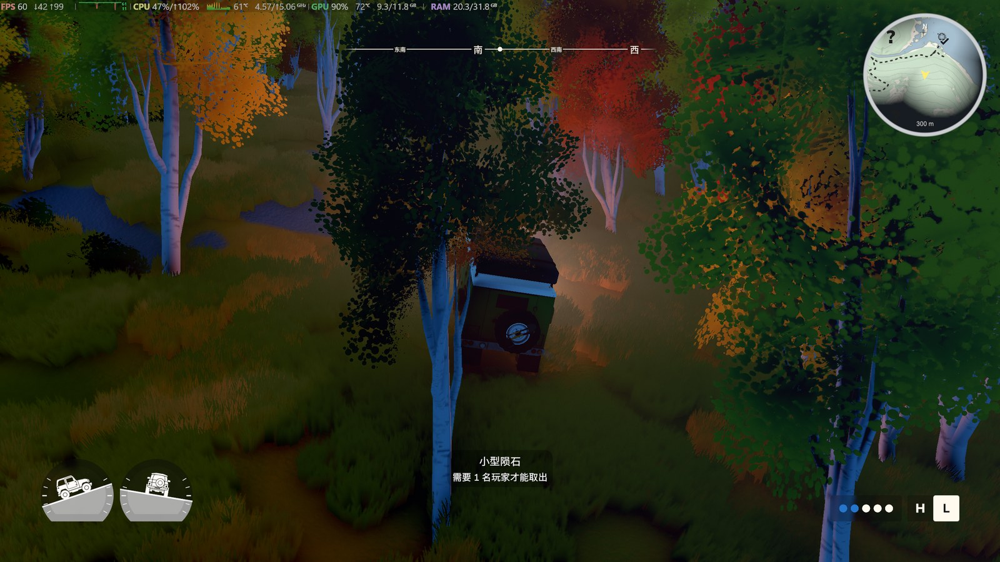

# over the hill · Mini Map（懒人完整包）

右上角圆形小地图，只显示玩家附近区域。  
**这个包已经带好 BepInEx 6 + Unity 基础库**，不用先装环境。

| 项目 | 内容 |
| --- | --- |
| Mod 版本 | `1.3.0` |
| 游戏版本 | `0.0.1`（Unity `6000.0.75f1`，Steam AppID `2929250`） |
| 平台 | Windows x64 |
| 包内环境 | BepInEx 6.0.0-be.789（Unity IL2CPP）+ Unity 6000.0.75 基础库 |
| 联机 | 纯客户端，朋友不装也能一起玩 |

> 非官方社区 Mod，与 Funselektor Labs 无关。使用风险自负。

---

## 它能做什么

- 右上角圆形小地图，默认直径 `240px`
- 只显示周围 **300 米**，可配置
- 叠加游戏战争迷雾，**不会把整张地图摊开**
- 还没到达的兴趣点显示游戏原版 **“?”** 图标，已到达显示类型图标
- 好友图钉 / 队友标记会显示在小地图上（如果当前 HUD 有）
- 固定北朝上，黄色箭头是车头方向
- 主菜单、大厅、暂停菜单、大地图、商店等界面自动隐藏
- **正常退出游戏时自动备份存档**（默认开启）

---

## 实机截图

<p align="center">
  <br>
  <em>游戏内效果（白天）</em>
</p>

<p align="center">
  <br>
  <em>游戏内效果（夜间）</em>
</p>

<p align="center">
  <br>
  <em>细节：问号、好友图钉、车头方向、300 米刻度</em>
</p>

---

## 安装（3 步）

1. **完全退出游戏**（不是最小化，也不是回主菜单）。
2. 解压本包，**双击 `安装.bat`**。
3. 从 Steam 正常启动游戏，进入驾驶状态。

安装脚本会自动：

- 找到 Steam 游戏目录
- 如果没有 BepInEx：解压包内自带的 BepInEx 6 加载器
- 放入 Unity 基础库
- 放入小地图插件和默认配置

如果自动定位失败：

```powershell
powershell -ExecutionPolicy Bypass -File .\安装.ps1 -GamePath "D:\SteamLibrary\steamapps\common\over the hill"
```

### 第一次启动

如果这是游戏第一次带 BepInEx 启动，需要生成 IL2CPP 程序集，可能要等 **1～3 分钟**，期间不要强制关闭。

日志：

```text
游戏目录\BepInEx\LogOutput.log
```

正常应看到：

```text
Loading [over the hill - Mini Map 1.3.0]
Mini Map v1.3.0 loaded.
小地图 UI 已创建（进入游戏后首次加载）。
小地图已就绪：地图 ...
```

> 如果杀毒软件拦截 `winhttp.dll`，请放行；这是 BepInEx 的注入文件，常见误报。

### 已经装过 BepInEx？

安装脚本会自动检测并跳过加载器安装，只更新小地图，不会覆盖你的配置。

---

## 配置

配置文件：

```text
游戏目录\BepInEx\config\com.dsh.overthehill.minimap.cfg
```

```toml
[General]
Enabled = true
Size = 240
Margin = 24
RangeMeters = 300
Opacity = 0.94

[Markers]
ShowKnown = true
MaxMarkers = 10
UseGameIcons = true

[Map]
ShowFog = true
ShowLabels = true
FlipMapY = false

[SaveBackup]
BackupOnExit = true
Keep = 10
IncludeAnimalPhotos = false
```

| 配置 | 默认 | 说明 |
| --- | --- | --- |
| `Enabled` | `true` | 是否显示小地图 |
| `Size` | `240` | 圆形直径（160–420） |
| `Margin` | `24` | 距离屏幕右上角的边距 |
| `RangeMeters` | `300` | 显示半径（米） |
| `Opacity` | `0.94` | 底图不透明度 |
| `ShowKnown` | `true` | 显示范围内已到达的兴趣点 |
| `MaxMarkers` | `10` | 最多显示几个标记 |
| `UseGameIcons` | `true` | 使用游戏原版图标；找不到时用字母圆点 |
| `ShowFog` | `true` | 显示战争迷雾 |
| `ShowLabels` | `true` | 显示指北针和距离刻度 |
| `FlipMapY` | `false` | 地图前后方向反了就改成 `true` |
| `BackupOnExit` | `true` | 正常退出时自动备份存档 |
| `Keep` | `10` | 最多保留几份退出备份 |
| `IncludeAnimalPhotos` | `false` | 备份时是否连动物照片一起复制 |

改完配置需要重启游戏。

---

## 自动备份存档

正常退出游戏时，游戏会先保存，然后 Mod 把存档复制到：

```text
文档\My Games\over the hill\Backups\yyyyMMdd-HHmmss\
```

每份备份包含：

```text
Player1.json
Player1.json.bak
FogOfWar\*.fow
manifest.txt
```

- 默认保留最近 10 份，旧的自动清理
- 默认不复制 `Animals`（动物照片），体积较大
- 只在本机复制，不会上传
- 游戏崩溃、任务管理器强杀、断电不会触发；请手动复制 `Saves` 文件夹

---

## 多人游戏

小地图是纯客户端 UI：

- 你装了就你有，朋友不装也能正常进你的房间
- 每个人看到自己的小地图和探索状态
- 不会把“?”或队友位置同步给别人
- 不改变房间人数、联机协议或存档格式

---

## 卸载

**双击 `卸载.bat`**，或运行：

```powershell
powershell -ExecutionPolicy Bypass -File .\卸载.ps1
```

只删除小地图插件和（可选）配置，不会删除 BepInEx，也不会动其它 Mod。  
已经生成的 `Backups` 不会被删。

---

## 常见问题

| 现象 | 处理 |
| --- | --- |
| 双击安装没反应 | 在解压目录打开 PowerShell，运行 `powershell -ExecutionPolicy Bypass -File .\安装.ps1` |
| 右上角没有小地图 | 看日志是否有 `Mini Map v1.3.0 loaded`；确认已经进入驾驶状态 |
| 地图全黑 | 正常：未探索区域被迷雾盖住；把 `ShowFog` 改成 `false` 可确认底图 |
| 地图前后反了 | 把 `FlipMapY` 改成 `true`，重启游戏 |
| 退出后没有备份 | 确认是正常退出而不是强杀；日志里应有“已挂钩退出备份” |
| 杀毒报 `winhttp.dll` | 放行即可，这是 BepInEx 的注入文件，常见误报 |
| 游戏更新后失效 | 等 Mod 适配新版本；把 `LogOutput.log` 末尾发出来 |

---

## 文件清单

```text
OverTheHill-MiniMap-1.3.0-Full\
├─ README.md
├─ LICENSE
├─ CHANGELOG.md
├─ THIRD-PARTY-NOTICES.md
├─ 安装.bat / 安装.ps1 / install.ps1
├─ 卸载.bat / 卸载.ps1 / uninstall.ps1
├─ BepInEx\plugins\OverTheHill.MiniMap.dll
├─ BepInEx\config\com.dsh.overthehill.minimap.cfg
├─ Loader\BepInEx-Unity.IL2CPP-win-x64-6.0.0-be.789.zip
├─ Loader\unity-libs\6000.0.75.zip
└─ docs\images\*.jpg / *.png
```

校验：

```powershell
Get-FileHash .\BepInEx\plugins\OverTheHill.MiniMap.dll -Algorithm SHA256
```

哈希见 `SHA256SUMS.txt`。

---

## License

Mod 本体使用 MIT License，见 [LICENSE](LICENSE)。  
包内 BepInEx / Unity 基础库的许可证与来源见 [THIRD-PARTY-NOTICES.md](THIRD-PARTY-NOTICES.md)。
