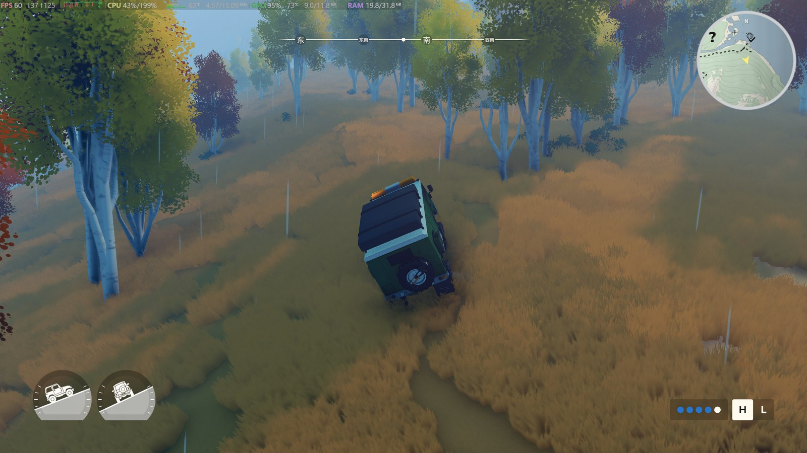
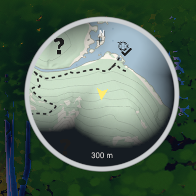

# over the hill · Mini Map

A circular minimap for **over the hill** that shows only the area around the player — no full-map reveal.

[中文说明 / Chinese README](README-zh.md)



## Features

- Circular minimap in the top-right corner, 240 px by default
- Shows a local **300 m** window (configurable)
- Uses the game's own fog of war; the full map is never opened
- Nearby undiscovered points of interest use the game's original **?** icons
- Visited POIs and friend/teammate markers use the game's own icons
- North-up display with a yellow vehicle heading arrow
- Automatically hides in menus, the lobby, the big map and shops
- Automatically backs up saves on a normal game exit (enabled by default)



## Installation (lazy full package)

This repository includes:

- BepInEx `6.0.0-be.789` (Unity IL2CPP)
- Unity `6000.0.75` base libraries
- The Mini Map plugin and default config
- Install / uninstall scripts

1. **Quit the game completely.**
2. Download or clone this repository.
3. Double-click **`安装.bat`**.

The installer finds the Steam game folder, installs BepInEx if it is missing, copies the Unity libraries and installs the plugin.

If auto-detection fails:

```powershell
powershell -ExecutionPolicy Bypass -File .\安装.ps1 -GamePath "D:\SteamLibrary\steamapps\common\over the hill"
```

The first BepInEx launch can take **1–3 minutes** while IL2CPP assemblies are generated. Do not force-close it.

> Windows SmartScreen/antivirus may flag `winhttp.dll`; this is the normal BepInEx injection DLL.

## Configuration

`BepInEx\config\com.dsh.overthehill.minimap.cfg`

```toml
[General]
Enabled = true
Size = 240
Margin = 24
RangeMeters = 300
Opacity = 0.94

[Markers]
ShowKnown = true
MaxMarkers = 10
UseGameIcons = true

[Map]
ShowFog = true
ShowLabels = true
FlipMapY = false

[SaveBackup]
BackupOnExit = true
Keep = 10
IncludeAnimalPhotos = false
```

Set `FlipMapY = true` if the map is oriented backwards. Restart the game after changing the config.

## Save backups

On a normal exit, the game saves first, then the mod copies:

- `Player*.json`
- `FogOfWar\*.fow`
- `manifest.txt`

to:

```text
Documents\My Games\over the hill\Backups\yyyyMMdd-HHmmss\
```

The last 10 backups are kept. Crashes, force-kills and power loss do not trigger the exit hook.

## Multiplayer

The minimap is a client-side UI mod:

- Friends do **not** need it to join your room.
- Each player sees their own map and exploration state.
- No markers, map data or player positions are sent over the network.

## Uninstall

Double-click `卸载.bat`, or run:

```powershell
powershell -ExecutionPolicy Bypass -File .\卸载.ps1
```

This removes the Mini Map plugin and leaves BepInEx and other mods untouched.

## Notes

- Game version: `0.0.1` (Unity `6000.0.75f1`, Steam AppID `2929250`)
- Platform: Windows x64
- Community mod, not affiliated with Funselektor Labs.

## License

MIT for the Mini Map mod. BepInEx and Unity libraries keep their original licenses; see [THIRD-PARTY-NOTICES.md](THIRD-PARTY-NOTICES.md).
